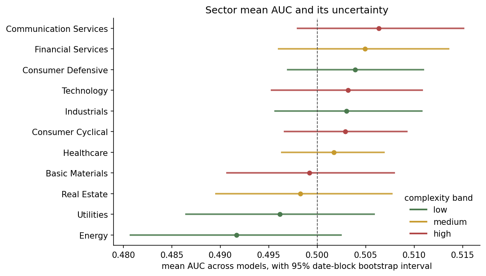
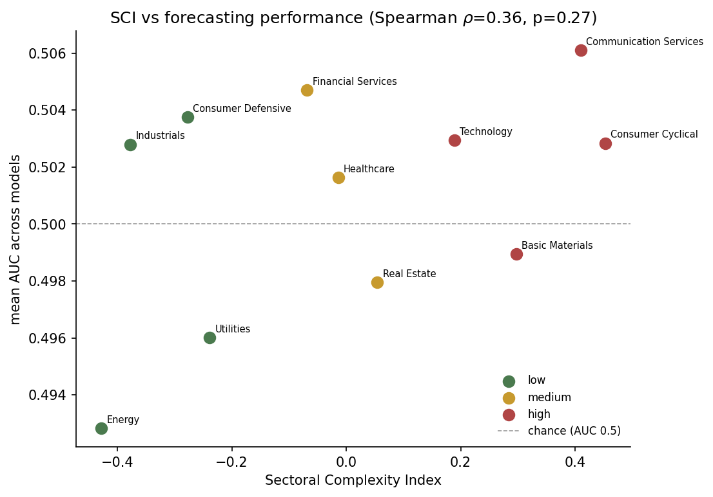
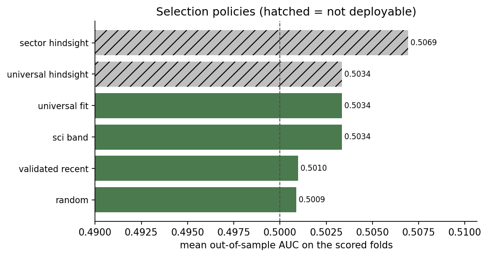

# Sectoral Heterogeneity in Stock Price Direction Forecasting: Implications for AI-Driven Investment Decision Support

Code and outputs for my MSc Artificial Intelligence dissertation (Northumbria University, 2026).

Machine learning studies of stock price direction often report very different results even when using similar methods. This project tests one possible reason: that models perform differently depending on which part of the market they are applied to. It asks whether the structural complexity of an S&P 500 sector, measured *before* any model is trained, explains how well models forecast its next-day return direction, and whether that complexity could be used to choose models inside an investment decision support system.

## Key findings

**Sectors do differ, but none beats chance.** Forecasting performance differs significantly across sectors (Friedman χ² = 30.77, p = 0.0006, Kendall's W = 0.154). The spread from best to worst sector is 0.0133 AUC, above the largest noise floor of 0.0081. Communication Services ranks highest (AUC 0.5061) and Energy lowest (0.4928), and this ordering survives changes of seed, sampling and period. Yet no sector's 95% confidence interval excludes AUC = 0.5, and only 2 of 44 model-sector cells beat a constant baseline on accuracy. Relative differences exist; usable skill does not.

**Sector complexity does not explain the differences.** The relationship runs opposite to the hypothesis (Spearman ρ = +0.364, p = 0.272, bootstrap CI [−0.191, +0.636]). Four of the five index components carry the wrong sign, and none survives Holm correction. A within-sector panel analysis across all 220 model-sector-fold cells estimates +0.0002 AUC per standard deviation of complexity (p = 0.937), which is effectively zero.

**No model-selection rule beats one fixed model.** Selecting models by complexity band gives exactly the same result as using one fixed model (AUC 0.5034). Selecting on recent validated performance does worse (0.5010), level with random choice. Picking the best model per sector with hindsight reaches 0.5069 (Wilcoxon p = 0.031), so a gain exists, but no rule available in advance captures it.

**Models use the same information everywhere.** SHAP attribution shows lagged returns account for 34–43% of attribution in every sector, unrelated to complexity. Sector explains 25% of AUC variance and period 9%, while around two-thirds comes from sector-by-period interaction. The most predictable sector moves over time, so no static property can track it.

**Two common evaluation choices can mislead.**
- *Pooling predictions across folds.* The share of up days drifts from 0.499 to 0.531 between folds. Mean AUC is 0.5010 scored within folds but 0.4982 when pooled; the conclusion flips in 11 of 44 cells, and the largest gap (0.0227) is nearly twice the whole sector spread.
- *Uncorrected accuracy under selective prediction.* Keeping only the most confident 10% of predictions lifts LSTM accuracy from 0.5103 to 0.5262, but the majority-class rate on those same rows rises to 0.5265. All 20 model-coverage combinations show negative skill.

**Implications for decision support systems:** don't choose models by pre-computed sector complexity; don't switch models on recent performance when the signal is weak, as switching follows noise; score abstaining systems against the class balance of the rows they cover; and treat the evaluation protocol as part of the system design.

<!-- Add figures once PNG versions are in results/figures/, for example:

-->

## Study design

| | |
|---|---|
| **Data** | 523 S&P 500 constituents across 11 sectors, daily prices and volumes, 2020–2025 (589,884 observations) |
| **Features** | 13 price and volume features |
| **Models** | Logistic regression, random forest, XGBoost, LSTM (PyTorch) |
| **Experiments** | 4 model families × 11 sectors × 5 folds = 220 cells |
| **Validation** | Five-fold expanding-origin walk-forward; AUC scored within each fold, never pooled |
| **Inference** | Date-block bootstrap, Friedman, Wilcoxon and McNemar tests, Holm correction, three noise floors |
| **Complexity index** | Standardised mean of volatility, sample entropy, Hurst exponent (sign reversed), Amihud illiquidity and volume variability, rebuilt per fold from a trailing 250-day window |
| **Interpretability** | SHAP attribution by feature group and sector (XGBoost) |

## Running it

    python pipeline.py          # fits the models and runs every analysis
    python figures.py           # builds the figures from results/

`pipeline.py` takes about 40 minutes from scratch and 25 minutes if `results/predictions.parquet` is present, since it reuses the cached predictions rather than refitting.

Requires Python 3.13. Install dependencies with `pip install -r requirements.txt`. For a CPU-only PyTorch install, see [pytorch.org](https://pytorch.org/get-started/locally/). If the environment line printed at startup does not read `xgboost yes | torch yes`, stop: the run would silently proceed with three model families instead of four.

## What is here

### Code

| file | purpose |
| --- | --- |
| `pipeline.py` | data preparation, the complexity index, walk-forward forecasting, all hypothesis tests, diagnostics and robustness checks |
| `figures.py` | every figure in the dissertation and its appendices |

### Inputs (not included)

The input data is not included in this repository. `pipeline.py` expects two files in the same folder:

- `merged_data.csv`: daily prices and volumes for 523 S&P 500 constituents from 2020 to 2025, with columns `date`, `ticker`, `Open`, `High`, `Low`, `Close` and `Volume`.
- `ticker_sectors.xlsx`: maps each ticker (`ticker`) to one of eleven sectors (`Sector`).

The original panel also carried a sentiment column belonging to a related project. The pipeline explicitly excludes it from the feature set.

### Outputs, in `results/`

`predictions.parquet` is the prediction cache, and the reason a re-run reproduces the reported results exactly rather than refitting. The remaining CSVs are the per-analysis results: performance by model and sector, bootstrap intervals, the complexity index, the panel regression, temporal and regime decompositions, selection policies, selective prediction, SHAP attribution and the robustness checks. `rq_summary.json` collects every test statistic in one place, and the `tab_*.tex` files are the LaTeX table bodies used in the dissertation. `figures/` can be rebuilt from the CSVs at any time.

## Reproducibility

All randomness is seeded: the bootstrap, the LSTM initialisations, the random selection baseline and the model fits. The run reported in the dissertation completed in 24.9 minutes from cache under Python 3.13.14 with numpy 2.5.2 and pandas 3.0.5. Results have been observed to shift slightly across XGBoost versions, so the versions printed at startup are worth recording alongside any new run.

## Limitations

- Only 11 sectors of unequal size (21 to 80 stocks), and the first principal component explains only 39% of the complexity index's variance.
- Price and volume features only, one market, and a 2020–2025 window that includes COVID-19.
- Default hyperparameters and no transaction-cost backtest. This is deliberate: results reflect the models under one consistent setup, not their best tuned performance.

## Author

Yuvraj Sachan, MSc Artificial Intelligence, Northumbria University.
